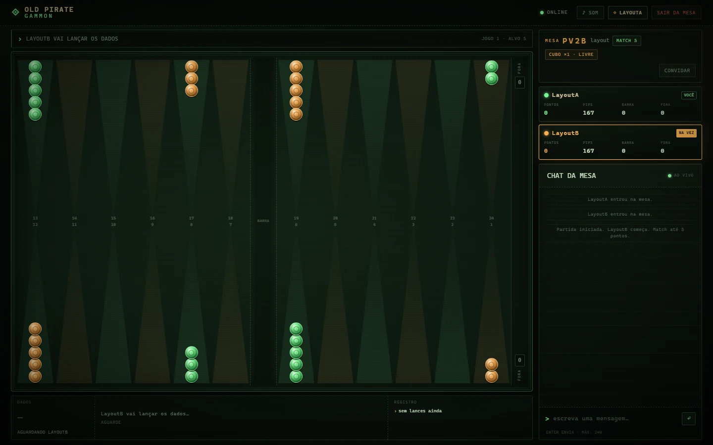
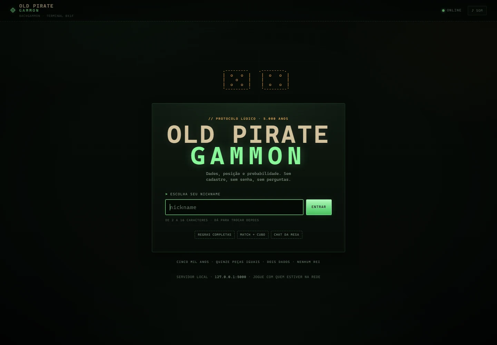

<div align="center">

# OLD PIRATE GAMMON

**Backgammon.** Cinco mil anos, quinze peças iguais, dois dados e nenhuma necessidade de um rei.


</div>

> *Old Pirate* é o nome do projeto — um velho alter ego. O jogo é gamão.



<p align="center"><sub>Tabuleiro, painel da mesa e chat na mesma janela.</sub></p>

---

## Um protocolo lúdico com cinco mil anos

O gamão é um dos jogos de tabuleiro mais antigos de que se tem registro. Jogos de percurso com dados e peças já existiam há cerca de 5.000 anos na antiga Mesopotâmia e no Egito. O **Jogo Real de Ur** é um desses ancestrais. Os romanos jogavam versões conhecidas como *Ludus Duodecim Scriptorum* e *Tabula*, já muito próximas do gamão moderno. O jogo atravessou a Idade Média, enfrentou proibições religiosas e sobreviveu nas tavernas, nas ruas e nas casas. Mudou de nome, de formato e de território, mas continuou circulando.

Um jogo portátil, dobrável, que cabe numa maleta, numa caixa de madeira ou numa mesa de bar: uma tecnologia social de baixíssimo custo de implementação e altíssima longevidade. Um protocolo lúdico com cinco milênios de idade.

Eis uma das coisas que me fascinam no gamão: sua capacidade de sobreviver às mudanças históricas sem perder sua estrutura essencial.

## O acaso como arquitetura

Diferente do xadrez, que é um jogo determinístico de informação perfeita, o gamão incorpora uma variável aleatória a cada turno: os dados. Eles introduzem ruído no sistema, alteram o espaço de possibilidades e obrigam o jogador a recalcular continuamente suas estratégias. Não basta encontrar a sequência teoricamente correta de movimentos. É preciso trabalhar com distribuições de probabilidade, administrar posições e tomar decisões a partir de informações incompletas sobre o futuro.

Do ponto de vista da programação, isso significa construir uma máquina de estados, implementar um motor de regras, validar movimentos, controlar turnos, gerar números aleatórios, administrar partidas simultâneas e garantir que o sistema não entre em estados inválidos. O desafio não é só fazer o código funcionar quando tudo acontece como esperado, mas garantir a consistência diante de milhares de combinações possíveis.

O acaso não é uma falha do sistema. É parte constitutiva da arquitetura.

## Quinze peças iguais

O gamão é uma espécie de antítese do xadrez. O xadrez é o teatro da sociedade de classes: um rei, uma rainha, bispos, cavalos, torres e uma massa de peões sacrificáveis. Cada peça nasce com uma posição hierárquica determinada, um conjunto desigual de capacidades e um papel específico na reprodução da ordem. O rei precisa ser protegido. Os peões podem ser descartados. A rainha concentra uma capacidade extraordinária de intervenção.

No gamão não há reis, rainhas, clero ou aristocracia. As quinze peças de cada jogador são absolutamente iguais. Não existe uma peça mais importante, mais poderosa ou com maior capacidade de movimento. O que muda é sua posição no tabuleiro e a maneira como se organizam coletivamente. Uma peça isolada pode ser capturada. Duas ou mais reunidas formam um ponto ocupado, inacessível ao adversário. A força não está na excepcionalidade de um indivíduo, mas na associação.

O território também não é propriedade permanente. As 24 casas do tabuleiro são espaços de ocupação temporária. Você constrói posições, estabelece pontos de apoio, bloqueia passagens e organiza sua circulação. Mas nenhuma casa é sua para sempre. Há algo de uma *Temporary Autonomous Zone* nessa dinâmica: territórios provisórios, construídos pela associação, cuja existência depende das condições concretas de sua ocupação.

E então chegamos ao objetivo final. No Banco Imobiliário, vence quem concentra propriedades, acumula capital e leva os adversários à falência. No xadrez, a vitória é decretada pela captura simbólica do soberano adversário. No gamão, você precisa retirar todas as suas peças do tabuleiro.

Vencer não significa conquistar o tabuleiro, acumular propriedades ou eliminar o adversário. Significa completar um percurso e libertar as peças da própria estrutura do jogo. O objetivo final do gamão é a libertação.

**Old Pirate → Backgammon.**

## O que está aqui

Uma implementação local-first desse jogo: um motor de regras completo, um servidor de partidas em tempo real, chat e uma interface de terminal vintage. Sem cadastro, sem senha, sem banco de dados. O servidor é a autoridade; o cliente só envia intenções de movimento.

- **Lobby em tempo real** — mesas abertas, entrada por código, matchmaking rápido e espectadores.
- **Nickname livre** — 2 a 16 caracteres, trocável a qualquer momento.
- **Tabuleiro completo** — 24 pontos, barra, casa, captura, reentrada e saída.
- **Chat da mesa** — durante toda a partida, inclusive para quem está assistindo.
- **Reconexão** — token de assento salvo no navegador; F5 ou queda de rede não perdem a partida.
- **Sessão local** — botão de logout e um reset de mesas em um clique (`zerar_mesas.bat`).
- **Cubo de dobra, match play e regra de Crawford** — implementados no servidor.
- **Interface responsiva** — no desktop a tela inteira cabe na janela, sem rolagem de página; no celular a interface se reorganiza.
- **WebSocket nativo com gevent** e fallback para polling.
- **Sem persistência** — reiniciar o processo zera mesas, chats e partidas.

## Como rodar

Requisitos: **Python 3.10+**.

```bash
git clone https://github.com/nomadcoy/old_pirate_backgammon.git
cd old_pirate_backgammon
python -m pip install -r requirements.txt
python app.py
```

No Windows, também é possível dar **duplo clique em `iniciar.bat`** — ele instala as dependências na primeira execução e inicia o servidor.

Abra **http://127.0.0.1:5000**.

O servidor escuta em `0.0.0.0:5000` e imprime o endereço de LAN no console. Para jogar com outras pessoas na mesma rede, compartilhe esse endereço — ou use o painel **CONVITE** dentro do lobby.

## Zerar mesas e voltar ao login

As mesas, sessões e partidas vivem em memória. Para começar do zero:

- **Duplo clique em `zerar_mesas.bat`** — encerra o servidor na porta 5000, sobe um processo limpo e abre `http://127.0.0.1:5000/?sair=1` diretamente na tela de login.
- **Botão `logout` no topo** — encerra a sessão local, libera sua mesa/assento e volta ao login sem reiniciar o servidor. Se estiver numa partida, ele avisa que a partida será encerrada.
- **Link direto** — `http://127.0.0.1:5000/?sair=1` limpa o nickname/token salvos no navegador e abre o login.
- **Manual** — `Ctrl+C` no servidor e `python app.py` (ou `iniciar.bat`) zera todas as mesas; depois abra o link com `?sair=1` para voltar ao login.

Ao reiniciar o servidor, amigos que estiverem em mesas também são desconectados. Avise antes, se houver partida rolando.

### Porta diferente

```powershell
$env:OPG_PORT=5001; python app.py
```

O padrão é **5000**.

### Firewall do Windows

Na primeira execução, permita o Python na rede **privada**. Se ninguém conseguir conectar, abra o PowerShell como administrador e rode:

```powershell
New-NetFirewallRule -DisplayName "Old Pirate Gammon (porta 5000)" `
  -Direction Inbound -Protocol TCP -LocalPort 5000 -Action Allow -Profile Private
```

> O projeto foi pensado para rodar na sua máquina ou na sua LAN. Não exponha o servidor diretamente à internet sem um proxy e uma camada de autenticação.

## Regras implementadas

- Movimento na direção correta para cada jogador; dados usados separadamente, inclusive duplos (4 jogadas).
- **Obrigação de usar os dois dados** quando possível; se apenas um puder ser jogado, vale o **maior**.
- Bloqueio de pontos, captura de *blots* e reentrada obrigatória pela barra.
- **Saída** apenas com todas as fichas em casa; dado exato, ou dado maior tirado da ficha mais avançada.
- **Dance** (sem jogadas) com passe automático.
- **Gammon** (2×) e **backgammon** (3×).
- **Cubo de dobra** antes de rolar: aceitar (dobra e passa a ser do aceitante) ou recusar (entrega o valor atual).
- **Match play** até 3, 5, 7 ou 11 pontos, com **regra de Crawford** e alternância de quem começa.
- Placar, pip count, barra e fichas fora visíveis o tempo todo.

## Como jogar

1. Digite um nickname e clique em **ENTRAR**.
2. **JOGAR AGORA** para achar adversário, **CRIAR MESA** para abrir a sua, ou entre pelo código / link.
3. Na sua vez, clique em **LANÇAR DADOS** (ou **DOBRAR**, antes de lançar).
4. Clique numa ficha iluminada e depois no destino iluminado. Para tirar ficha, selecione-a e clique na faixa **FORA** à direita — ou clique na ficha de novo.
5. O chat fica no painel lateral durante toda a partida.
6. Ao fim do jogo, **PRÓXIMO JOGO**; ao fim do match, **NOVO MATCH**.

Atalhos: `Esc` cancela a seleção. `Enter` envia o chat.

## Arquitetura

```
old_pirate_backgammon/
├─ app.py                 # Flask + Socket.IO: sessões, mesas, lobby, chat, ações
├─ game.py                # motor de regras completo, independente da interface
├─ templates/index.html   # login, lobby e tela de jogo
├─ static/css/style.css   # estética de terminal vintage
├─ static/js/app.js       # tabuleiro, interação, estado, chat
├─ static/vendor/         # cliente Socket.IO local (funciona offline)
├─ docs/                  # capturas de tela
├─ test_game.py           # testes do motor (regras + fuzz)
├─ requirements.txt
├─ iniciar.bat
├─ zerar_mesas.bat
└─ README.md
```

O desenho é deliberadamente simples:

- `game.py` não conhece Flask, navegador nem Socket.IO. Ele recebe estado e devolve jogadas válidas, fim de turno, placar e resultado.
- `app.py` mantém as mesas em memória, autentica assentos por token, controla o chat e transmite o estado.
- O cliente renderiza o estado e envia `from`/`to`; o servidor valida tudo. Não há confiança no cliente.
- O estado é uma máquina finita: turno, fase, dados, jogadas restantes, cubo, Crawford e match. As transições inválidas são rejeitadas.
- `gevent` entrega o WebSocket; se não estiver disponível, o servidor cai para `threading` e o cliente negocia polling.
- Tudo em memória: não há banco de dados, fila externa ou serviço de terceiros.

## Testes

```bash
python -m unittest test_game -v
```

Os testes cobrem barra, bloqueio, captura, saída exata/maior, duplos, regra do dado maior, Crawford, cubo, gammon/backgammon e **150 partidas aleatórias completas** contra o motor. O fuzz existe para caçar estados inválidos — exatamente o tipo de problema que aparece quando o acaso faz parte da arquitetura.

## Notas

- Projeto pessoal, feito para jogar com amigos na mesma rede.
- As partidas vivem em memória; reiniciar o servidor limpa tudo.
- Não há contas, histórico persistente nem classificação. A entrada é livre por nickname.
- O cliente Socket.IO 4.8.1 em `static/vendor/` é distribuído sob licença MIT e fica versionado para o jogo funcionar offline.
- Interface em português; código e regras em Python.

---

<details>
<summary>Mais uma captura: tela de entrada</summary>



</details>

---

Cinco mil anos de história, quinze peças iguais, dois dados e nenhuma necessidade de um rei.

O objetivo final do gamão é a libertação.
